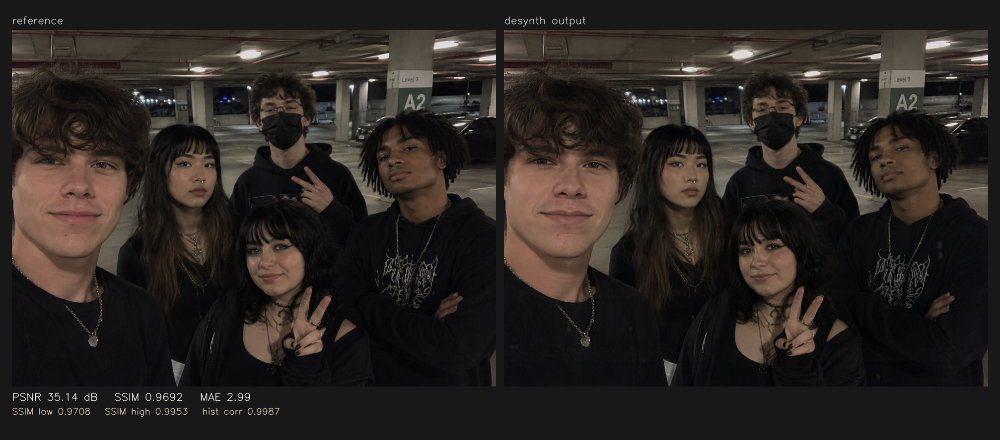
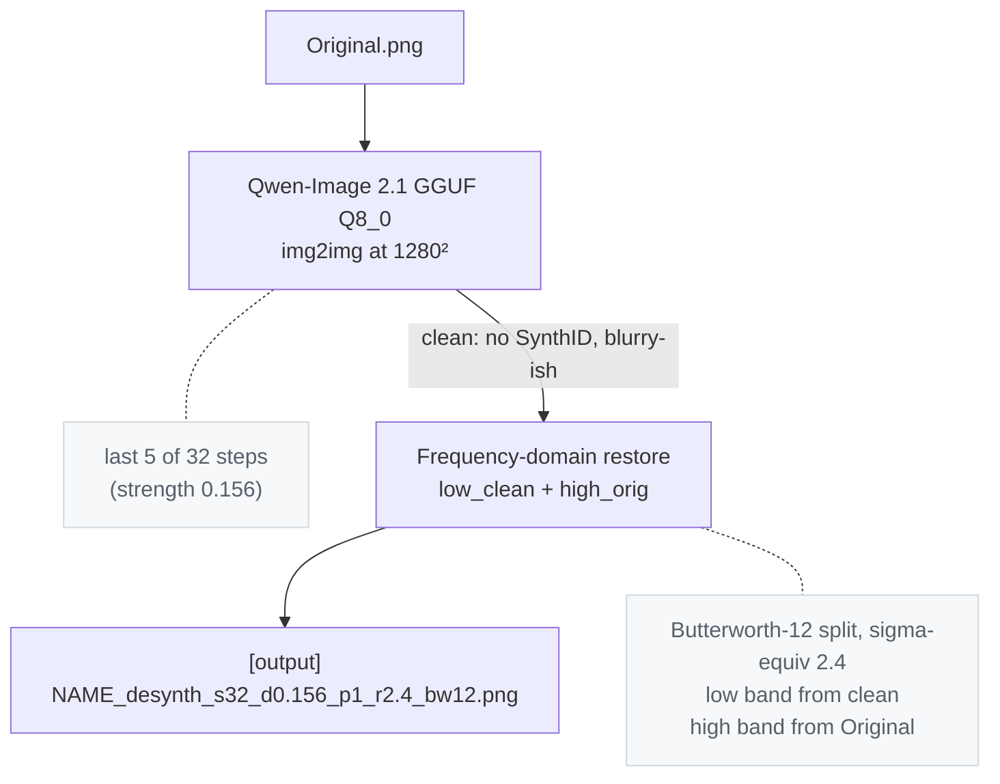

# Desynth

A tool & pipeline for removing OpenAI & Google's SynthID watermark from images.  
This project is intended solely for research, education, and authorized evaluation.

## Results


## Metrics
All scores are input image vs output via the included `compare.py`.

### Against other research (Gemini/Google, 2752×1536)
Measured with the previous Qwen-Image 2512 pipeline.

| metric                 | our method | [competitor](https://github.com/00quebec/Synthid-Bypass) |
|------------------------|--------------:|-----------------:|
| PSNR                   |  **28.75 dB** |  20.21 dB        |
| SSIM                   |     **0.946** |     0.624        |
| SSIM (low-frequency)   |     **0.944** |     0.812        |
| SSIM (high-frequency)  |     **0.987** |     0.641        |
| MAE (lower is better)  |      **5.33** |    12.18         |
| Output resolution      |   2752×1536   |    1501×835      |
| SynthID verdict        |   not found   |    not found     |


### Our own test image (GPT Image 2.0/OpenAI, 1460×1078)

| metric                 | default       |
|------------------------|--------------:|
| PSNR                   |  **35.14 dB** |
| SSIM                   |     **0.969** |
| SSIM (low-frequency)   |     **0.971** |
| SSIM (high-frequency)  |     **0.995** |
| MAE                    |      **2.99** |
| SynthID verdict        |   not found   |


## How it works



## Usage

Download the transformer into the repo root:

| file                                | size    | source |
|-------------------------------------|---------|--------|
| `qwen-image-2.1-Q8_0.gguf`          | ~7.6 GB | [unsloth/Qwen-Image-2.1-GGUF](https://huggingface.co/unsloth/Qwen-Image-2.1-GGUF) |
| `pytorch_lora_weights.safetensors`  | ~67 MB  | [lightx2v/Qwen-Image-2.1-Lightning](https://huggingface.co/lightx2v/Qwen-Image-2.1-Lightning) (optional, only for `--lightning-weight`) |


### Run

```powershell
python desynth.py                          # processes original.png
python desynth.py path\to\image.png        # processes any input
```

Output: `out/<name>_desynth_s32_d0.156_p1_r2.4_bw12.png`. Random seed per run by
default. First run downloads ~1.4 GB of VAE, processor and configs from
Hugging Face and caches them.

### Flags

| flag                  | default | when to use |
|-----------------------|---------|-------------|
| `--seed N`            | random  | reproducible runs |
| `--denoise X [X X]`   | 0.15625 | sweep denoise (5/32) |
| `--steps N`           | 32      | per-pass step count |
| `--passes N`          | 1       | iterate img2img |
| `--restore-sigma X [X X]` | 2.4 | tune / sweep detail restore (gaussian/edge default 0.8) |
| `--restore-mode M`    | butterworth | `gaussian` for the old soft crossover; `edge` for shape-coherent contours |
| `--restore-order N`   | 12      | butterworth steepness; sigma means the Gaussian with the same crossover point |
| `--unsharp X`         | 0.0     | post-restore sharpen; 0.2 is the perceptual sweet spot |
| `--no-restore`        | off     | skip the frequency restore step |
| `--keep-intermediate` | off     | save the pre-restore clean output |
| `--transformer PATH`  | Q8_0    | try a different GGUF quant |
| `--resolution N`      | 1280    | sampling area N×N px (aspect follows input); higher keeps more detail |
| `--lightning-weight X`| 0       | Lightning LoRA strength (0.8 if used); 0 = off |

### Quality check

```powershell
python compare.py Original.png out\<output>.png
```

Prints PSNR, SSIM (full + low/high band), MAE, MSE, and per-channel
histogram correlation.

## Files

| file                                                      | role                                                       |
|-----------------------------------------------------------|------------------------------------------------------------|
| `desynth.py`                                              | main pipeline: img2img + restore in one call               |
| `compare.py`                                              | similarity metrics between two images                      |
| `precompute_embeds.py`                                    | rebuilds `embeds_cache.pt` (downloads ~17.5 GB text encoder) |
| `embeds_cache.pt`                                         | cached prompt embeddings (~200 KB)            |
| `qwen-image-2.1-Q8_0.gguf`                                | Qwen-Image 2.1 transformer, GGUF Q8_0 quant (~7.6 GB)      |
| `pytorch_lora_weights.safetensors`                        | Qwen-Image 2.1 Lightning LoRA (~67 MB, optional)           |

## Hardware Requirements

Tested on Windows 10, RTX 5060 Ti 8 GB, 32 GB DDR4 RAM.
Sequential CPU offload is required with < 12GB VRAM

## Known limitations

- The default restore cutoff (2.4) sits one step under where SynthID returns
  (2.6 passes, 2.8 fails). Other `--resolution`, `--steps`, `--denoise` or
  `--lightning-weight` settings move that limit.
- `edge` mode is untested with Qwen-Image 2.1.

## Credits

Baseline workflow and watermark hypothesis from
[00quebec/Synthid-Bypass](https://github.com/00quebec/Synthid-Bypass).  
This pipeline reimplements the core idea in plain Python without ComfyUI,
ControlNet, or the face-detail path, and replaces the heavier redraw with a
five-step minimum denoise + frequency-domain restore.
